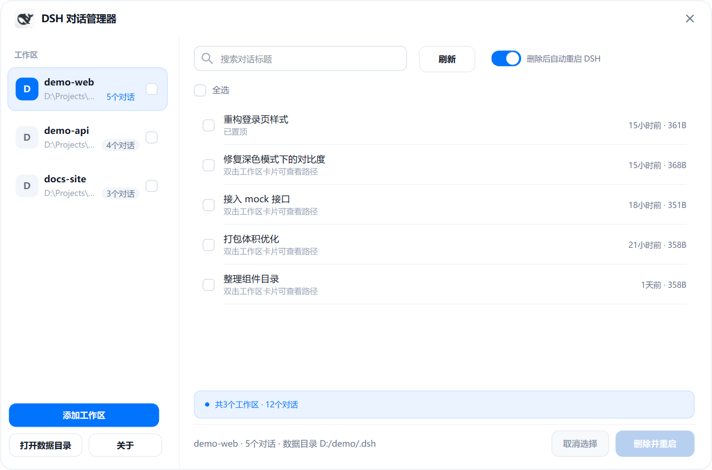

# DSHManager

> 一个安静的小工具：把 DeepSeek Harness 的本地对话整理得干干净净。

DeepSeek Harness（DSH）会把每个对话按工作区存在本地。用得久了，工作区里会堆几十个对话，想删掉几条却只能翻文件管理器。
**DSHManager** 把这件事变成一个能看懂、能点、能确认的小窗口：按工作区浏览、搜索、勾选、删除，删完自动把 DSH 重新拉起来。

## 功能

- **两栏浏览**：左边工作区（名称 / 路径 / 对话数），右边对话列表（标题、相对时间、体积）。
- **批量删除**：勾选任意多个对话 → 「删除所选（n）」→ 确认框列出将被删除的内容 → 一次清掉。
- **整块选中工作区**：勾上工作区卡片即选中它全部对话，删除时一并移除登记；卡片复选框支持半选（只选了部分对话）。
- **跨工作区多选**：切换工作区不会清空已选内容，底部会显示「已选N个对话 · M个工作区」。
- **整组清理**：工作区卡片的「⋯」菜单仍可「仅删除工作区登记」或「删除全部对话」。
- **自动发现工作区**：启动时扫描 DSH 的全部工作区；磁盘上存在但没登记的对话，会按记录的工作目录自动聚合出来，标上「未登记」，点一下就登记回 DSH 配置。
- **手动添加工作区**：侧栏「添加工作区」选择任意文件夹，自动把该目录下的对话挂上去。
- **搜索**：按标题过滤；`/` 聚焦搜索框。
- **删除后自动重启**：默认开启，可在右上角关闭。
- **可诊断的重启**：失败时打印 `taskkill` 的退出码与原文；权限不足会提示并用 UAC 重试。
- **安全**：写 `workspace.json` 前自动备份，临时文件 + 原子替换，UTF-8 无 BOM；被占用的文件跳过并提示。



## 界面

两栏布局：左侧工作区卡片（名称 / 路径 / 对话数），右侧对话行（标题、相对时间、体积、复选框）；底部是动作栏，删除时会切换成四步进度（删文件 → 清理引用 → 备份写盘 → 重启 DSH）。

> 截图用 `source/dev/make_demo_home.py` 生成一份**虚构演示数据**，再由 `source/dev/shots.py` 渲染，不含任何真实用户内容。

## 下载与使用

1. 打开 [Releases](../../releases) 下载 `DSHManager.exe`（单文件，无需安装 Python）。
2. 双击运行。首次运行未签名程序可能触发 SmartScreen，选择「更多信息 → 仍要运行」。
3. 勾选要删除的对话，点右下角「删除所选」。

数据目录默认是 `%USERPROFILE%\.dsh`；如果你改过位置，设置环境变量 `DSH_HOME` 指向它即可。

> 删除的对话**无法恢复**。程序会在修改 `workspace.json` 前自动生成 `workspace.json.bak-<UTC 时间戳>`，但会话日志本身删了就是删了。

## 界面设计

柔和极简的桌面工具风：白底、浅灰面板、单一蓝色强调色、克制的留白，参考 Fluent 与 macOS 设置面板的克制感。所有控件自绘，不依赖系统主题：

| 项 | 取值 |
|---|---|
| 窗口 | `#FFFFFF` 底 + 1px `#E5EBF3` 边框 + 圆角 16 无边框 |
| 面 | `#F7F9FC` / `#F2F6FB` |
| 文字 | `#101828` / `#667085` / `#98A2B3` |
| 强调 | `#0074FD`（soft `#EAF3FF`） |
| 语义 | 成功 `#12945F`、警告 `#B54708`、危险 `#D92D20` |
| 字体 | Microsoft YaHei UI |

## 版本

- **v2.0.0**（当前）：Python + PySide6 图形界面重写，新增工作区自动发现 / 手动添加，重启流程重做。详见 [CHANGELOG.md](CHANGELOG.md)。
- **v1.0.0**：C# 壳 + Node 脚本的控制台版本，源码保留在 `source/legacy/`。

## 从源码构建

```powershell
cd source
python -m venv .venv
.\.venv\Scripts\python.exe -m pip install -r build/requirements.txt
powershell -ExecutionPolicy Bypass -File build/build.ps1
```

产物：`source/build/DSHManager.exe`，并自动复制到项目根目录。

开发调试：

```powershell
.\.venv\Scripts\python.exe -m dshmanager                     # 直接跑界面
.\.venv\Scripts\python.exe -m dshmanager --selftest out.json   # 无界面自检
.\.venv\Scripts\python.exe dev/test_sandbox.py                 # 沙盒删除测试
.\.venv\Scripts\python.exe dev/test_workspaces.py              # 工作区发现 / 登记测试
```

## 目录结构

```text
source/
├─ src/dshmanager/     theme · widgets · dialogs · model · zstdlog · store · restart · ui_main
├─ dev/                截图、沙盒测试、图标生成
├─ build/              PyInstaller 构建脚本与依赖
└─ legacy/             v1.0 的 C# + Node 实现
```

## 工作原理（简述）

- 会话日志是**多帧 zstd**，只读文件头尾即可取到 id、工作目录和标题；
- 删除 = 删会话目录 + 会话缓存 + 从 `workspace.json` 的 `sessionIds / archivedSessionIds / pinnedSessionIds` 里摘掉；
- 删除工作区 = 只删登记，文件夹和日志保留（与 DSH 一致）；
- 重启 = 先起一个等待进程盯住 DSH 的全部 PID，再用 `taskkill` 结束，等它们真正退出后立刻拉起（不会双开）。

## 许可

MIT，见 [LICENSE](LICENSE)。